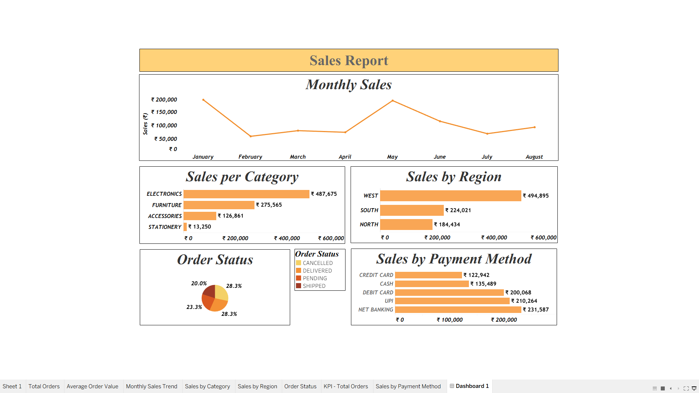

# 📊 Retail Sales Analytics Dashboard

An end-to-end **Retail Sales Data Analytics project** built using Tableau Prep Builder and Tableau Public to clean, analyze, and visualize retail sales data through an interactive dashboard.

The project transforms raw retail data into meaningful business insights, helping stakeholders understand sales performance across months, product categories, regions, order statuses, and payment methods.

## 📸 Dashboard Preview



## 🎯 Project Objectives

- Clean and prepare raw retail sales data using Tableau Prep Builder.
- Analyze sales performance across different business dimensions.
- Identify top-performing product categories and regions.
- Track monthly sales trends and order status distribution.
- Visualize payment method performance through interactive charts.
- Present key findings in a clear, business-friendly dashboard.

## 🛠️ Tech Stack

- **Tableau Prep Builder** — Data cleaning and preparation
- **Tableau Public** — Data visualization and dashboard development
- **Data Analytics** — Exploratory analysis and business insights

## 🔄 Project Workflow

1. **Data Preparation:** Imported the retail sales dataset into Tableau Prep Builder.
2. **Data Cleaning:** Cleaned and standardized relevant fields to prepare the dataset for analysis.
3. **Data Validation:** Reviewed the prepared data for consistency and usability.
4. **Data Visualization:** Connected the cleaned dataset to Tableau Public and created individual worksheets.
5. **Dashboard Development:** Combined the visualizations into a consolidated sales dashboard.

## 📈 Dashboard Features

| Visualization | Business Purpose |
|---|---|
| Monthly Sales Trend | Analyze changes in sales over time |
| Sales per Category | Compare revenue across product categories |
| Sales by Region | Identify high-performing geographical regions |
| Order Status | Understand the distribution of order statuses |
| Sales by Payment Method | Compare sales across different payment methods |

## 💡 Key Insights

- **Top Product Category:** Electronics generated the highest sales at ₹487,675.
- **Leading Region:** The West region recorded the highest sales at ₹494,895.
- **Leading Payment Method:** Net Banking recorded the highest sales at ₹231,587.
- **Order Status Distribution:** Delivered and Cancelled orders each represented 28.3% of the recorded orders.

*These figures reflect the current dataset and dashboard configuration.*

## 🧹 Data Preparation with Tableau Prep Builder

Tableau Prep Builder was used to prepare the raw dataset before visualization.

The preparation workflow focused on:

- Cleaning and standardizing data fields.
- Handling data quality issues where applicable.
- Preparing consistent dimensions and measures for analysis.
- Producing a cleaned dataset suitable for Tableau dashboards.

## 📂 Repository Structure

```text
Retail-Sales-Analytics/
│
├── images/
│   └── retail-sales-dashboard.png
│
├── data/
│   └── Retail_Sales_Cleaned_Final.csv
│
├── tableau-prep/
│   └── Retail_Sales_Cleaning.tfl
│
├── Retail_Sales_Dashboard.twbx
└── README.md
```

*Adjust the filenames and folders to match the files you actually upload. Include the Tableau Prep flow and packaged workbook only if you have saved them.*

## 🚀 How to Explore the Project

1. Clone or download this repository.
2. Open the Tableau Prep Builder flow, if included, to explore the data preparation process.
3. Open the Tableau workbook in Tableau Desktop or Tableau Public, depending on the workbook format and compatibility.
4. Explore the visualizations and compare sales across business dimensions.

## 📚 Skills Demonstrated

- Data Cleaning and Preparation
- Exploratory Data Analysis
- Data Visualization
- Dashboard Design
- Business Intelligence
- Retail Sales Analysis
- Tableau Prep Builder
- Tableau Public

## 👨‍💻 Author

**Arman Shikalgar**

Aspiring Data Analyst | Python Developer

